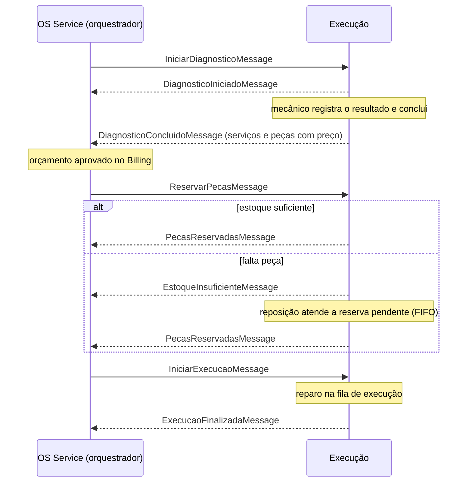

# Execucao Service — Oficina Mecânica

[](https://sonarcloud.io/summary/new_code?id=tech-challenge-grupo-160_tech-challenge-oficina-mecanica-execucao) [](https://sonarcloud.io/summary/overall?id=tech-challenge-grupo-160_tech-challenge-oficina-mecanica-execucao) [](https://sonarcloud.io/summary/overall?id=tech-challenge-grupo-160_tech-challenge-oficina-mecanica-execucao) [](https://sonarcloud.io/summary/overall?id=tech-challenge-grupo-160_tech-challenge-oficina-mecanica-execucao)

Microsserviço da Fase 4 do Tech Challenge (FIAP SOAT, Grupo 160).

**Responsabilidade:** Diagnóstico e reparo, fila de execução, catálogo de serviços e peças, estoque, reserva de peças e pedidos de compra.

Faz parte da divisão definida na [ADR-0003](https://github.com/tech-challenge-grupo-160/tech-challenge-oficina-mecanica/blob/develop/docs/adrs/0003-divisao-em-microsservicos.md):

| Serviço | Repositório |
|---|---|
| OS Service | [tech-challenge-oficina-mecanica](https://github.com/tech-challenge-grupo-160/tech-challenge-oficina-mecanica) |
| Billing | [tech-challenge-oficina-mecanica-billing](https://github.com/tech-challenge-grupo-160/tech-challenge-oficina-mecanica-billing) |
| Execução | [tech-challenge-oficina-mecanica-execucao](https://github.com/tech-challenge-grupo-160/tech-challenge-oficina-mecanica-execucao) |

Infraestrutura compartilhada: [rede, EKS, API Gateway e ALB](https://github.com/tech-challenge-grupo-160/tech-challenge-infra-k8s),
[bancos RDS](https://github.com/tech-challenge-grupo-160/tech-challenge-infra-database),
[Lambda de autenticação](https://github.com/tech-challenge-grupo-160/tech-challenge-lambda-auth) e
[pipeline reutilizável](https://github.com/tech-challenge-grupo-160/tech-challenge-pipelines).
Diagramas da arquitetura: [docs/diagrams do OS Service](https://github.com/tech-challenge-grupo-160/tech-challenge-oficina-mecanica/tree/develop/docs/diagrams).

## Papel na Saga

A OS é coordenada por uma **Saga orquestrada pelo OS Service**
([ADR-0004](https://github.com/tech-challenge-grupo-160/tech-challenge-oficina-mecanica/blob/develop/docs/adrs/0004-saga-orquestrada.md);
a justificativa está no [README do OS Service](https://github.com/tech-challenge-grupo-160/tech-challenge-oficina-mecanica#saga-orquestrada)).
A Execução é um participante: recebe comandos do orquestrador, executa a
transação local no seu PostgreSQL e publica o resultado. Ela não conhece o
Billing nem altera o status da OS.



A falta de estoque é a compensação que passa pela Execução: o OS segura a OS em
`AguardandoEstoque` e a retoma quando a reposição completa a reserva.

## Contratos

Todas as mensagens têm versão 1, `MessageId` (idempotência pela Inbox) e
`CorrelationId` (a saga da OS). O catálogo completo está no
[repositório do OS Service](https://github.com/tech-challenge-grupo-160/tech-challenge-oficina-mecanica/blob/develop/docs/mensageria/catalogo.md).

### Comandos consumidos (SQS)

| Mensagem | Fila | O que faz |
|---|---|---|
| `IniciarDiagnosticoMessage` | `...-execucao-iniciar-diagnostico` | Abre o diagnóstico da OS (idempotente) |
| `ReservarPecasMessage` | `...-execucao-reservar-pecas` | Reserva as peças do orçamento aprovado |
| `IniciarExecucaoMessage` | `...-execucao-iniciar-reparo` | Coloca a OS na fila de execução |

### Eventos publicados (SNS `tc-grupo160-<ambiente>-execucao-events`)

| Mensagem | Quando |
|---|---|
| `DiagnosticoIniciadoMessage` | Diagnóstico aberto |
| `DiagnosticoConcluidoMessage` | Diagnóstico concluído, com serviços e peças precificados |
| `PecasReservadasMessage` | Todas as peças reservadas (inclusive depois de reposição) |
| `EstoqueInsuficienteMessage` | Reserva parcial; informa o que falta |
| `ExecucaoFinalizadaMessage` | Reparo concluído |

### Endpoints

| Método | Rota | Uso |
|---|---|---|
| `POST` | `/api/v1/catalogo/itens/consultar` | Snapshots comerciais para o OS Service (síncrono, na abertura da OS) |
| `POST` | `/api/v1/diagnosticos` | Abrir diagnóstico manualmente |
| `GET` | `/api/v1/diagnosticos/ordem-servico/{ordemServicoId}` | Consultar o diagnóstico |
| `PUT` / `GET` | `/api/v1/diagnosticos/ordem-servico/{ordemServicoId}/resultado` | Registrar e consultar o resultado técnico |
| `PATCH` | `/api/v1/diagnosticos/ordem-servico/{ordemServicoId}/concluir` | Concluir o diagnóstico (publica `DiagnosticoConcluidoMessage`) |
| `POST` | `/api/v1/estoque/pecas/{pecaId}/reposicoes` | Entrada de estoque; atende reservas pendentes |
| `GET` | `/api/v1/execucoes/fila` | Fila de execução |
| `GET` | `/api/v1/execucoes/ordem-servico/{ordemServicoId}` | Consultar a execução da OS |
| `PATCH` | `/api/v1/execucoes/ordem-servico/{ordemServicoId}/finalizar` | Finalizar o reparo (publica `ExecucaoFinalizadaMessage`) |

O contrato OpenAPI está em [docs/openapi/execucao.json](docs/openapi/execucao.json)
e os contratos internos, em [docs/API_CONTRACTS.md](docs/API_CONTRACTS.md). Na
AWS, as rotas chegam pelo API Gateway (com o authorizer JWT) e pelo ALB, que
encaminha `/api/v1/catalogo*`, `/api/v1/diagnosticos*`, `/api/v1/estoque*` e
`/api/v1/execucoes*` à Execução.

## Stack

.NET 10 · ASP.NET Core · Clean Architecture (API → Application → Domain → Infrastructure) · MediatR com `ValidationBehavior` · FluentValidation · logs em JSON · Datadog .NET Tracer na imagem.

Banco: PostgreSQL em instância RDS própria (`tc-grupo160-<ambiente>-execucao`), provisionada no [tech-challenge-infra-database](https://github.com/tech-challenge-grupo-160/tech-challenge-infra-database) pela [F4-12](https://github.com/tech-challenge-grupo-160/tech-challenge-oficina-mecanica/issues/143) ([ADR-0006](https://github.com/tech-challenge-grupo-160/tech-challenge-oficina-mecanica/blob/develop/docs/adrs/0006-banco-por-servico.md)). Nenhum outro serviço acessa esse banco. A integração assíncrona usa SNS/SQS, Outbox e Inbox; no Docker local, esses recursos são fornecidos pelo LocalStack do OS Service.

## Estrutura

```
src/
  API/              controllers, bootstrap, filtros, ProblemDetails
  Application/      comandos, consultas e handlers (MediatR), validação
  Domain/           entidades e regras de negócio
  Infrastructure/   persistência, mensageria, health checks, logs
  Shared/           código compartilhado entre camadas (LogTemplate)
tests/
  Fiap.TechChallenge.OficinaMecanica.Execucao.Test.UnitTests/
  Fiap.TechChallenge.OficinaMecanica.Execucao.Test.IntegrationTests/
infra/              Terraform SNS/SQS, DLQs e configuração no Secrets Manager
docker/backend/     Dockerfile (desenvolvimento, build e runtime com o tracer)
k8s/                Deployment, Service, HPA e ConfigMap (Kustomize)
```

A infraestrutura de mensageria e os passos de provisionamento estão em
[infra/README.md](infra/README.md). O catálogo comum está no
[repositório OS Service](https://github.com/tech-challenge-grupo-160/tech-challenge-oficina-mecanica/blob/develop/docs/mensageria/catalogo.md).

## Como rodar

```bash
dotnet run --project src/API/Fiap.TechChallenge.OficinaMecanica.Execucao.Api.csproj
```

Ou com Docker. A mensageria usa o LocalStack que sobe no compose do OS Service;
para o fluxo completo com os três serviços, siga o
[guia de execução local](https://github.com/tech-challenge-grupo-160/tech-challenge-oficina-mecanica/blob/develop/docs/EXECUCAO-LOCAL.md).
O `.env.example` já tem valores que funcionam localmente:

```bash
cp .env.example .env
docker compose up -d --build
```

A API sobe em `http://localhost:8082`, com Swagger em `/swagger` no ambiente de desenvolvimento.

| Endpoint | Para quê |
|---|---|
| `/health/live` | O processo está de pé (liveness do Kubernetes) |
| `/health/ready` | O serviço e suas dependências estão prontos (readiness) |
| `/health` | Relatório completo em JSON |

O PostgreSQL da Execucao fica exposto em `localhost:5433` e usa o database `oficina_execucao`. As migrations e o seed inicial sao aplicados na inicializacao da API.

O endpoint interno `POST /api/v1/catalogo/itens/consultar` fornece snapshots comerciais ao OS Service sem expor estoque. Consulte [os contratos internos](docs/API_CONTRACTS.md).

O endpoint `POST /api/v1/estoque/pecas/{pecaId}/reposicoes` registra uma entrada
de estoque. Reservas pendentes sao reprocessadas em FIFO na mesma transacao; as
OSs totalmente atendidas sao liberadas por `PecasReservadasMessage`, publicado
pela Outbox no SNS. Consulte [os contratos internos](docs/API_CONTRACTS.md).

O seed inicial disponibiliza IDs estaveis de `1000` a `1007`:

| ID | Servico | ID | Peca |
|---:|---|---:|---|
| 1000 | Alinhamento | 1000 | Pastilha de Freio |
| 1001 | Troca de Oleo | 1001 | Oleo de Motor 5W30 - 5L |
| 1002 | Balanceamento | 1002 | Filtro de Oleo |
| 1003 | Revisao do Sistema de Freios | 1003 | Disco de Freio |
| 1004 | Diagnostico Eletronico | 1004 | Correia Dentada |
| 1005 | Troca da Correia Dentada | 1005 | Vela de Ignicao |
| 1006 | Higienizacao do Ar-Condicionado | 1006 | Filtro de Ar-Condicionado |
| 1007 | Revisao Preventiva | 1007 | Bateria 60Ah |

## Testes

```bash
dotnet test Fiap.TechChallenge.OficinaMecanica.Execucao.slnx --collect:"XPlat Code Coverage" --settings coverlet.runsettings
```

A meta da fase é cobertura mínima de 80%, verificada no SonarCloud ([F4-09](https://github.com/tech-challenge-grupo-160/tech-challenge-oficina-mecanica/issues/140)).

**Cobertura:** 91,5% na última análise de PR, com o quality gate aprovado
([painel no SonarCloud](https://sonarcloud.io/summary/overall?id=tech-challenge-grupo-160_tech-challenge-oficina-mecanica-execucao)).
O badge no topo mostra a análise da branch principal.

O fluxo completo da OS, com as compensações, é coberto pelo
[BDD do OS Service](https://github.com/tech-challenge-grupo-160/tech-challenge-oficina-mecanica#bdd-do-fluxo-completo-da-os-f4-36).

## Pipeline

O [`pipeline.yml`](.github/workflows/pipeline.yml) chama o pipeline reutilizável
[`servico-dotnet.yml@v1`](https://github.com/tech-challenge-grupo-160/tech-challenge-pipelines):

| Gatilho | O que roda |
|---|---|
| PR para `develop`, `homolog` ou `main` | build, testes, SonarCloud e build da imagem |
| push na `homolog` / `main` | imagem no ECR e deploy no EKS de homologação / produção |
| disparo manual | deploy no ambiente escolhido (dev) |

O `terraform-messaging.yml` cuida da mensageria (`infra/`): roda o plan nos
PRs e aplica no push da `develop`.

## Fluxo de branches

`feature/*` → `develop` → `homolog` → `main`, com Conventional Commits; `homolog` e `main` só recebem alterações por PR. Detalhes no [CONTRIBUTING do repositório principal](https://github.com/tech-challenge-grupo-160/tech-challenge-oficina-mecanica/blob/develop/CONTRIBUTING.md).
